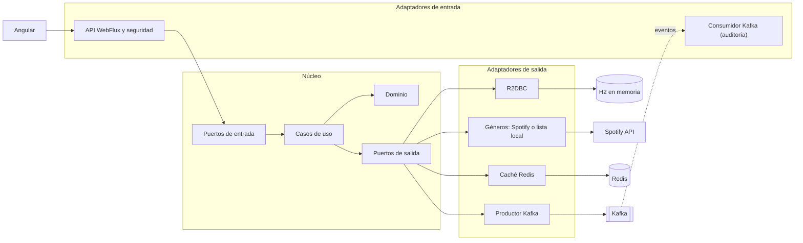
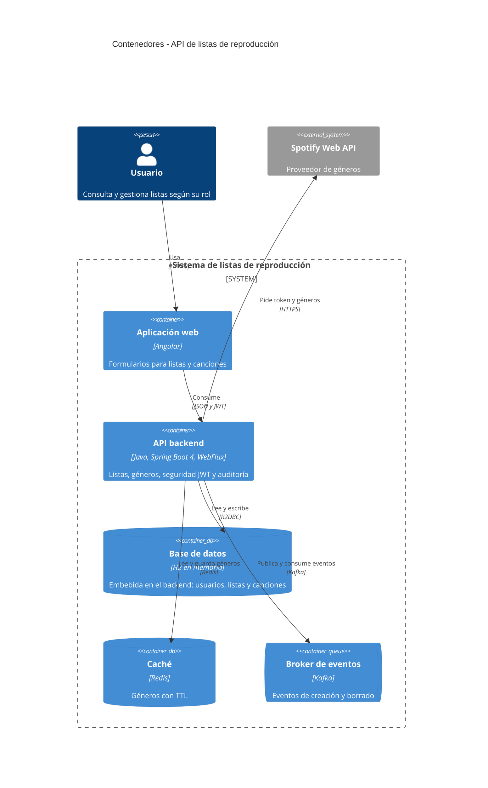
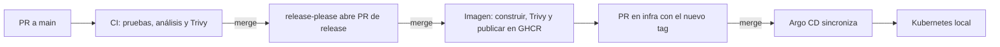

# ADR-0001: Arquitectura de la API de listas de reproducción

- **Estado:** Aceptado 
- **Fecha:** 2026-11-26
- **Actualizado:** 2026-11-26. Se reemplaza el monorepo por tres repositorios (sección 3), se añade Argo CD (sección 7) y CI/CD con GitHub Actions (sección 13). El backlog se agrupa en 11 historias: la prueba de Spotify pasa de la fase 1 a la 3 (sección 10 y orden de ejecución) y el CI en verde en infra se exige desde la fase 9 (sección 13).
- **Ubicación:** `docs/adr/0001-arquitectura-api-listas-reproduccion.md` en el repositorio de backend

## Diagrama de flujo

## Diagrama C4 nivel de contenedores

## Contexto

Aplicacion de listas de reproducción de música, con API REST para crear, consultar y borrar listas y sus canciones. La aplicación debe ser segura, reactiva y escalable, con un frontend web que consuma la API.

### Requisitos del enunciado

- Maven, JPA y base de datos en ejecución (sugerencia: H2).
- API REST:

| Método | URI | Respuestas |
|---|---|---|
| POST | `/lists` | 201 con URI y contenido; 400 si el nombre no es válido |
| GET | `/lists` | Todas las listas |
| GET | `/lists/{listName}` | La lista; 404 si no existe |
| DELETE | `/lists/{listName}` | 204; 404 si no existe |

- Lista: `nombre`, `descripcion`, `canciones[]`. Canción: `titulo`, `artista`, `album`, `anno`, `genero`.
- Autenticación y autorización, preferiblemente con JWT.
- Pruebas unitarias.
- Consumo en el backend del servicio de géneros de Spotify.
- Cliente REST configurado (Postman o similar).
- Proyecto web con formularios que consuman la API.
- Repositorio en GitHub o GitLab con historial de commits.

## Decisiones

### 1. Java 21, Spring Boot 4.0, WebFlux y R2DBC

**Decisión:** Java 21 (confirmado), Spring Boot 4.1.x, Spring WebFlux y **Spring Data R2DBC** con H2 en memoria (`r2dbc-h2`).

**Cambio de versión (2026-11-26):** se había elegido la línea 4.0, cuyo soporte gratuito [termina el 31 de diciembre de 2026](https://endoflife.date/spring-boot). Se usa la 4.1.

**Desviación del enunciado:** el enunciado pide **JPA** y aquí **no se usa**. JPA trabaja sobre JDBC, que es bloqueante y contradice el paradigma reactivo. R2DBC permite una cadena no bloqueante desde la petición hasta el controlador de base de datos. El README debe explicar esta decisión de forma visible.

**Consecuencias:**
- **Riesgo de evaluación:** se puede considerar un requisito incumplido. Conviene consultarlo con quien envió la prueba antes de entregar.
- No hay relaciones ni cascadas automáticas. Listas y canciones son dos tablas; el adaptador las guarda, compone y borra de forma explícita.
- Las operaciones sobre ambas tablas van en una transacción reactiva (`TransactionalOperator`).
- El esquema se define en SQL (`schema.sql`), con restricción de unicidad en el nombre y clave foránea de canción a lista.
- La persistencia queda tras un puerto: un adaptador JPA podría sustituir al de R2DBC sin tocar dominio ni aplicación.
- No se permiten llamadas bloqueantes en el event loop.
- Boot 4 trae Jackson 3, starters modulares y cambios en las anotaciones de prueba. Verificar la compatibilidad de cada librería (springdoc 3.x para Boot 4).
- Revisar el calendario de soporte de la línea en uso y mantener su último parche.

**Alternativas descartadas:**
- Spring MVC con JPA y virtual threads: es lo más simple y cumple el requisito, pero se elige el modelo reactivo.
- WebFlux con JPA en `boundedElastic`: cumple el requisito, pero la persistencia sigue siendo bloqueante.

### 2. Arquitectura hexagonal estricta con módulos Maven

| Módulo | Contenido | Puede depender de |
|---|---|---|
| `domain` | Entidades, reglas y excepciones. Sin frameworks. | Nada |
| `application` | Casos de uso y puertos de entrada y salida | `domain`, Reactor |
| `infrastructure` | Adaptadores: web, seguridad, R2DBC, Spotify, Redis, Kafka | `application`, `domain` |
| `bootstrap` | Arranque, configuración y ensamblaje | Todos |

- Los puertos devuelven `Mono` o `Flux`. Reactor es la única dependencia externa permitida en `application`.
- DTOs, entidades de persistencia y modelo de dominio son clases distintas, con mapeadores.
- Una prueba con ArchUnit verifica las reglas de dependencia.

**Consecuencias:** límites claros y casos de uso probables sin infraestructura, a cambio de más código de mapeo.

### 3. Tres repositorios en GitHub

| Repositorio (público) | Contenido |
|---|---|
| `quipux-playlist-backend` | Proyecto Maven multimódulo, Dockerfile, `postman/`, `docs/adr/` y README principal |
| `quipux-playlist-frontend` | Angular, Dockerfile con nginx |
| `quipux-playlist-infra` | `compose/`, `k8s/` (Kustomize) y `argocd/` |

El README del backend es el punto de entrada y enlaza los otros dos.

**Consecuencias:** cada repositorio tiene su propio pipeline y versionado, y el despliegue queda separado del código. A cambio, hay más configuración inicial y un cambio de contrato puede requerir commits en dos repositorios.

**Alternativa descartada:** monorepo (decisión anterior de este ADR).

### 4. OpenAPI con Swagger UI

springdoc-openapi para WebFlux, con el esquema Bearer JWT declarado.

**Concreción (2026-11-26, HU-06):**
- springdoc 3.2.0. La 3.2.1 se compila contra Spring Boot 4.2 y se usa la línea 4.1.
- El contrato (`/v3/api-docs`) y Swagger UI se abren sin token. El resto sigue protegido.
- Generar el contrato y servir la interfaz hace lecturas bloqueantes. Un filtro ejecuta solo esas rutas en
  `boundedElastic`, incluidas `/v3/api-docs.yaml` y `/webjars/**`, que exigen token.
- swagger-core añade Jackson 2 como dependencia. La API sigue serializando con Jackson 3.

### 5. Redis como caché de géneros

- Se cachea la respuesta de Spotify con TTL configurable (inicial: 24 h), mediante el cliente reactivo.
- Si Redis falla, se consulta el origen. La caché no puede tumbar la API.

### 6. Kafka para eventos de dominio

- Eventos `PlaylistCreated` y `PlaylistDeleted`, publicados después del commit a través de un puerto.
- Un consumidor simple registra el evento como auditoría.
- La publicación es de mejor esfuerzo: se puede perder un evento. El patrón *outbox* queda como mejora futura.
- Si Kafka no está disponible, la petición HTTP no falla.

### 7. Docker, Kubernetes y GitOps con Argo CD

- Dockerfile multietapa en los repositorios de backend y frontend.
- `docker-compose` en el repositorio de infra: backend, frontend, Redis, Kafka (modo KRaft) y WireMock opcional. Construye desde las carpetas hermanas, así que no depende del CI. Es la forma de ejecución para quien evalúa.
- Manifiestos de Kubernetes con Kustomize en el repositorio de infra: Deployments, Services, ConfigMap, Secret de ejemplo y probes con Actuator.
- **Argo CD** en un clúster local sincroniza la rama `main` del repositorio de infra. El CI no despliega ni necesita acceso al clúster.
- El Secret real se crea a mano en el clúster. El de ejemplo no se incluye en `kustomization.yaml`, para que Argo CD no sobrescriba el real.
- El backend va con **una réplica**, porque H2 en memoria no se comparte entre pods. Los datos se pierden al reiniciar.
- Terraform queda fuera.
- **Concreción (2026-11-27, HU-07):** la composición lleva backend, frontend y WireMock; Redis y Kafka se añaden con
  HU-10 y HU-11, cuando la aplicación los use. WireMock se activa con un segundo archivo, `compose.wiremock.yaml`. Los
  puertos se publican solo en la máquina local. nginx reenvía `/api` con la ruta tal como llega, sin recodificarla.
- **Concreción (2026-11-27, HU-08):** las imágenes usan `eclipse-temurin:21.0.13.1_2-jre-alpine-3.24` (backend) y `nginxinc/nginx-unprivileged:1.31.7-alpine` (frontend, rama principal 1.31), ejecutando `apk upgrade --no-cache` en la etapa final como `root` y volviendo a usuario sin privilegios (`10001:10001` y `101`) para pasar Trivy.

### 8. Contrato y modelo de datos

- El código usa identificadores en inglés; el contrato JSON conserva los nombres en español del enunciado, mapeados en los DTOs.
- `nombre` es obligatorio, no vacío y **único**. Es el identificador en la URI.
- Nombre duplicado: `409 Conflict` (no está en el enunciado).
- `201` incluye la cabecera `Location` con el nombre codificado para URL.
- `anno` se mantiene como texto, igual que en el contrato.
- Errores con `ProblemDetail` (RFC 9457).
- **Cambio (2026-11-26, HU-03):** el nombre no puede contener, sin distinguir mayúsculas, `%2F`, `%5C`, `%00`, `%0A` o
  `%0D`, ni los separadores U+2028 y U+2029. Aceptarlos obligaba a desactivar diez reglas del filtro de rutas de
  Spring Security.

### 9. Seguridad

- `POST /auth/login` emite un JWT con expiración corta.
- Usuarios de demostración en H2 con contraseñas BCrypt.
- Rol `USER`: consultar. Rol `ADMIN`: además crear y borrar.
- Spring Security reactivo con validación de JWT. Clave de firma por variable de entorno.
- **Concreción (2026-11-26, HU-03):** firma HS256 y vigencia de 30 minutos. Las contraseñas de los usuarios de
  demostración también vienen del entorno. Del filtro de rutas solo se relajan dos reglas, para admitir `;` y `%` en
  los nombres. Sin límite de intentos de inicio de sesión ni revocación de tokens.

### 10. Géneros desde Spotify (riesgo alto)

Según la [guía de migración de febrero 2026](https://developer.spotify.com/documentation/web-api/tutorials/february-2026-migration-guide), las apps nuevas en modo desarrollo ya no tienen `GET /browse/categories` y el dueño necesita Premium activo. `GET /recommendations/available-genre-seeds` no figura como eliminado, pero su disponibilidad no está confirmada.

- **Primer paso de la fase de géneros (fase 3):** probar ambos endpoints con las credenciales reales.
- Puerto `GenreProvider` con un adaptador para Spotify (client credentials con `WebClient`) y otro de respaldo con una lista local.
- La API expone `GET /genres`, indica el origen de los datos y el README explica la limitación.
- Credenciales solo por variables de entorno. Nunca en el repositorio.
- Hay una app de Spotify con cuenta Premium. Si la integración real se complica, se usa **WireMock** para simular las respuestas de Spotify. Las URL base de Spotify son configurables para poder apuntar a uno u otro.
- **Verificación (2026-11-26, HU-04):** con las credenciales reales se obtiene el token con *client credentials*, pero
  `GET /v1/recommendations/available-genre-seeds` responde `404` y `GET /v1/browse/categories`, `403`. Con el mismo
  token, `GET /v1/search` responde `200`.
- **Decisión (2026-11-26, HU-04):** la integración sigue el formato documentado de `available-genre-seeds` y se simula
  con WireMock. Contra el Spotify real, `GET /genres` responde con la lista local.
- **Concreción (2026-11-26, HU-04):** al crear una lista se rechaza con `400` el género que no esté en el catálogo
  vigente (Spotify o lista local), sin distinguir mayúsculas.

### 11. Pruebas

- Dominio y casos de uso: JUnit 5, Mockito y `StepVerifier`.
- Web y seguridad: `WebTestClient` (201, 400, 401, 403, 404, 204).
- Persistencia: pruebas de repositorios R2DBC sobre H2 con `StepVerifier`, incluida la reversión de la transacción. Spotify: servidor HTTP simulado con WireMock.
- Redis y Kafka: pruebas de integración obligatorias con Testcontainers, incluidos los casos en que el servicio no está disponible. Requieren Docker en local y en el CI.
- Frontend: pruebas unitarias de servicios, interceptor, guardas y formularios con el ejecutor de pruebas de Angular CLI.
- Cobertura mínima del **80 %** de líneas por módulo del backend con JaCoCo. Se excluyen DTOs, configuración, mapeadores y excepciones. El código de dominio con reglas no se excluye.
- **Checkstyle** en el backend: líneas de 121 caracteres como máximo, llaves obligatorias y sin imports sin usar.
- `mvn verify` falla si no se cumple la cobertura o hay una violación de Checkstyle.

### 12. Frontend

Angular con componentes standalone y formularios reactivos: login, listado, detalle, creación con canciones y borrado. El selector de género consume `GET /genres`. Un interceptor añade el JWT.

Las opciones de crear y borrar se ocultan al rol `USER`. El backend sigue siendo quien autoriza.

La web llama a la API por una ruta del mismo origen: proxy de desarrollo de Angular en local y nginx en el contenedor. Así no se necesita configurar CORS.

### 13. CI/CD con GitHub Actions

| Control | Backend | Frontend | Infra |
|---|---|---|---|
| Compilación y pruebas | `mvn verify` (con Testcontainers) | npm | `kustomize build` |
| Cobertura | JaCoCo, mínimo 80 % | — | — |
| Análisis estático | Checkstyle y Qodana (`qodana-jvm-community`) | ESLint | — |
| Trivy | Dependencias, secretos e imagen | Dependencias, secretos e imagen | Configuración y secretos |
| release-please | Sí | Sí | Sí |

- **Qodana solo en backend:** su linter de JavaScript/TypeScript [requiere licencia de pago](https://jetbrains.com/help/qodana/linters.html). El de la comunidad cubre [Java, Kotlin y Groovy](https://jetbrains.com/help/qodana/jvm.html).
- **Acciones fijadas por SHA de commit**, no por tag. `trivy-action` sufrió en marzo de 2026 un [ataque a la cadena de suministro](https://github.com/aquasecurity/trivy/security/advisories/GHSA-69fq-xp46-6x23) que reescribió sus tags. Los permisos de cada workflow se limitan al mínimo.
- Trivy hace fallar el pipeline ante vulnerabilidades `HIGH` o `CRITICAL` con corrección disponible.
- release-please usa Conventional Commits. Lo que crea con `GITHUB_TOKEN` [no dispara otros workflows](https://github.com/googleapis/release-please-action), así que usa un token propio de cada repositorio: sin él, el CI no correría en el PR de release y la protección de `main` lo bloquearía. La imagen se construye en el mismo workflow, condicionada a `release_created`.
- **Rama `main` protegida** en los tres repositorios: los cambios entran por PR con el CI en verde. En infra se exige solo el PR hasta que exista su CI (fase 9). En el plan gratuito de GitHub esto requiere repositorios públicos.
- **Dependabot** propone actualizaciones de Maven, npm, Docker y GitHub Actions, incluidos los SHA fijados, con mensajes en formato Conventional Commits.
- Las imágenes se publican en GHCR con el número de versión como tag.
- **Concreción (2026-11-27, HU-08):** Qodana usa el perfil `qodana.starter` con umbral `0` para `Critical` y `High`; Trivy analiza el jar de `bootstrap` (`rootfs`) en backend y `package-lock.json` (`fs`) en frontend, además de secretos en ambos repositorios; el PR automático al repositorio de infra con el nuevo tag y su token quedan para HU-09.
- El workflow de la aplicación abre un PR en el repositorio de infra con el nuevo tag. Para esto necesita un token con permisos solo sobre ese repositorio, guardado como secreto. Al fusionar el PR, Argo CD despliega.

## Orden de ejecución

Se prioriza la calidad sobre el plazo. Las horas son una estimación orientativa, no un límite.

| Fase | Contenido | Horas |
|---|---|---|
| 1 | Repositorios, módulos Maven, JaCoCo y Checkstyle | 1,5 |
| 2 | Dominio, persistencia, 4 endpoints y sus pruebas | 3 |
| 3 | JWT, prueba de Spotify y géneros | 2 |
| 4 | Angular y sus pruebas | 2,5 |
| 5 | Postman, OpenAPI y README | 1 |
| 6 | Docker y Compose | 0,75 |
| 7 | CI: pruebas, Qodana, ESLint, Trivy, Dependabot y protección de `main` | 1,25 |
| 8 | release-please e imágenes en GHCR | 0,75 |
| 9 | Kubernetes en el repositorio de infra | 0,75 |
| 10 | Argo CD | 0,75 |
| 11 | Redis y sus pruebas con Testcontainers | 0,75 |
| 12 | Kafka y sus pruebas con Testcontainers | 1 |
| — | **Total** | **16** |

Las fases 1 a 5 cubren el enunciado y se terminan primero. Nunca se entrega una pieza a medias.

## Puntos confirmados (2026-11-26)

- [x] Java 21
- [x] Repositorio en GitHub
- [x] Secciones 8 a 12
- [x] R2DBC en lugar de JPA, consultándolo en paralelo con quien envió la prueba

## Pendiente (no bloquea el inicio)

- [ ] Respuesta sobre el uso de R2DBC en lugar de JPA
- [x] Tres repositorios públicos creados con los nombres de la sección 3
- [ ] Revisar los detalles propuestos en las secciones 7, 12 y 13
- [ ] Separar y rotar `RELEASE_PLEASE_TOKEN` en dos PATs independientes por repositorio (temporalmente compartido) y crear el token para los PR al repositorio de infra (HU-09)
- [x] Definir `SPOTIFY_CLIENT_ID` y `SPOTIFY_CLIENT_SECRET` y probar los endpoints

## Instrucciones para continuar con Claude Code

1. Leer este ADR y confirmar los puntos pendientes antes de escribir código.
2. Seguir el orden de fases, con commits pequeños y descriptivos.
3. Cerrar cada fase con las pruebas en verde.
4. Registrar cada cambio de decisión en un ADR nuevo o actualizando el estado de este.
